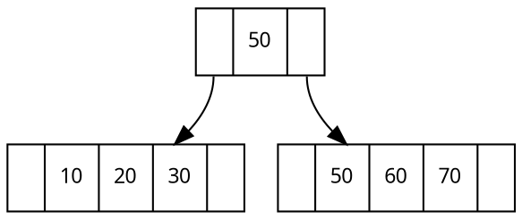

# freeride (F.R.E.E.-R.I.D.E.) 마스터 구현 계획서 (DOT 확정판)

> freeride — F.R.E.E.-R.I.D.E.
> Federated Repositories for Extracting Every Reference Into Developer-Executed Katas
> *(모든 레퍼런스 도서를 추출하여 개발자가 직접 손으로 쳐서 실행하는 수련 과제(Kata)로 바꾸는 연합 저장소)*
> *"이름은 무임승차(freeride)지만, 실체는 234권의 원서를 페이지마다 해부해 직접 손으로 코딩하고 테스트를 통과해야만 내릴 수 있는 수련 열차다."*

> 3대 핵심 원칙
> 1. doctree 자기 자신(Step 0)부터 먼저 개선·완성한 뒤 한 단계씩 결과를 눈으로 확인하며 진행한다.
> 2. 모든 도서의 원문 보관 폴더는 프로젝트/contents/ 로 통일한다.
> 3. 모든 다이어그램과 도식은 Graphviz DOT (dot 코드 블록 + dot -Tsvg 벡터 이미지) 로 단일 확정한다.

---

## 1. 현재 진행 현황 (Progress Tracker)

* [완료] 사전 준비 : 8개 전체 프로젝트의 도서 보관 폴더를 contents/ 로 통일
* [완료] Step 0 (doctree 개선) : 구글 드라이브 무규칙 PDF 대장 자동 갱신 (doctree update / classify / audit)
* [완료] Step 1 (3-Way 동기화) : 드라이브 ⟷ 로컬 contents/ 변경 감지 및 3-Way 비교·가져오기 (doctree sync / pull)
* [완료] Step 2 (구조 스캐폴딩) : 로컬 프로젝트 디렉토리 구조 강제 생성 및 규격 입출력 (doctree layout / scaffold)
* [완료] Step 3 (PDF 파싱 & 동일성 검증 — 중간 결과물) : 페이지별 .md + 크롭 .png + DOT .svg 생성 및 원본 PDF 5대 동일성 대조 검증 (doctree parse --verify)
* [완료] Step 4 (실습 생성 — 최종 결과물) : 중간 결과물(content_data/)을 조합해 실행·테스트 가능한 실습 코드(practice/) 생성 (doctree practice)

---

## 2. 전체 시스템 흐름도 (한눈에 보기)

```text
================================================================================
                  [ 전체 흐름: 도서 수집 ──► 파싱 ──► 실습 ]
================================================================================

  [구글 드라이브] (규칙 없이 PDF 업로드)
        │
        ▼
  ┌──────────────────────────────────────────────────────────────────────────┐
  │ Step 0. 스냅샷 갱신 및 분류 검증 ($ doctree update / classify)           │
  │   • 드라이브 전체 PDF 스캔 ──► 스냅샷 저장 및 변경/중복/분류 터미널 출력 │
  │   • 산출물: snapshots/YYYY-MM-DD.json (마크다운 대장 파일 생성 없음)     │
  └────────────────────────────────────┬─────────────────────────────────────┘
                                       │
                                       ▼
  ┌──────────────────────────────────────────────────────────────────────────┐
  │ Step 1. 양방향 변경 감지 & 3-Way 비교 ($ doctree sync / pull)            │
  │   • 드라이브 스냅샷(SHA-256) ⟷ 로컬 8개 프로젝트 contents/(SHA-256) 대조 │
  │   • 판별 결과 (터미널 출력):                                             │
  │     ① 드라이브에만 있는 것  ② 로컬에만 있는 것  ③ 양쪽 일치하는 것       │
  └────────────────────────────────────┬─────────────────────────────────────┘
                                       │
                                       ▼
  ┌──────────────────────────────────────────────────────────────────────────┐
  │ Step 2. 로컬 프로젝트 구조 강제 ($ doctree scaffold <프로필> <경로>)     │
  │   • 모든 프로젝트를 표준 폴더 구조로 생성 및 보정                        │
  │   • 표준 폴더: contents/ , content_data/ , practice/ , scripts/ , tips/  │
  └────────────────────────────────────┬─────────────────────────────────────┘
                                       │
                                       ▼
  ┌──────────────────────────────────────────────────────────────────────────┐
  │ Step 3. 페이지별 PDF 파싱 & 원본 동일성 검증 ($ doctree parse --verify)  │
  │   • 1차 (맥 M1 네이티브) : 페이지별 텍스트/코드 추출 + 그림 영역 .png 크롭│
  │   • 2차 (Antigravity Ultra + Graphviz DOT) :                             │
  │     크롭된 도식을 DOT 코드로 변환 & dot -Tsvg 로 .svg 벡터 이미지 생성   │
  │   • 3차 (동일성 기계 검증) : 원본 SHA-256·페이지 수·토큰/숫자 재현율·    │
  │     도식 수·코드/DOT 구문 컴파일 대조 후 index.json 에 PASS/WARN 기록    │
  │   • 산출물: content_data/<도서명>/[도서명-1page].md + assets/*.{png,svg} │
  └────────────────────────────────────┬─────────────────────────────────────┘
                                       │
                                       ▼
  ┌──────────────────────────────────────────────────────────────────────────┐
  │ Step 4. 학습·실습 프레임워크 생성 ──► [최종 결과물] (practice/)          │
  │   • 페이지별 중간 결과물(*page.md)을 장·절·주제 단위로 묶어 실습화       │
  │   • 산출물: practice/<도서>/<장_절>/<슬러그>/{README.md, main.*, test.*} │
  │   • 실행기: ./scripts/run.sh (0.1초 실행) / ./scripts/test.sh (검증)     │
  └──────────────────────────────────────────────────────────────────────────┘
```

---

## 3. 단계별 해야 할 일 (Step 0 ~ Step 4 상세)

### Step 0. doctree 자기 자신 개선 (doctree update / classify)
외부 프로젝트를 건드리기 전에 컨트롤 타워인 doctree 자체의 스냅샷 및 분류 관리 기능을 먼저 완성합니다.
* 할 일 1 (스냅샷 저장): 구글 드라이브의 모든 PDF를 찾아 `snapshots/YYYY-MM-DD.json` 으로만 저장합니다 (불필요한 마크다운 대장 파일 생성 없음).
* 할 일 2 (변경 감지): 직전 스냅샷과 파일 ID 기준으로 비교하여 [추가 / 삭제 / 이름변경 / 폴더이동 / 내용(SHA-256)변경]을 감지해 터미널에 요약 출력합니다.
* 할 일 3 (점검 및 분류 검증): SHA-256 완전 중복 파일·파일명 오류를 점검하고, `category_tree.yaml` 과 `content_category_map.yaml` 을 적용해 분류 트리 및 미분류 여부를 터미널에서 즉시 확인합니다.
* 할 일 4 (드라이브 & 로컬 PDF 이중 보안 점검 — `doctree audit`):
  * 구글 드라이브(원격): 스냅샷의 `sha256` 해시를 VirusTotal API v3로 조회(`snapshots/.vt_cache.json` 캐싱)하여 다운로드 전 악성/위변조 PDF를 사전 탐지합니다.
  * 로컬(`contents/*.pdf`): 로컬에 내려받은 모든 PDF의 실제 `sha256` 해시 계산, PDF 헤더(`%PDF-`)/종료(`%%EOF`) 손상 검사, 내부 위험 실행 태그(`/JavaScript`, `/JS`, `/Launch`, `/EmbeddedFiles`, `/RichMedia`, `/XFA`) 정적 스캔 및 VirusTotal 평판 대조를 수행합니다.

---

### Step 1. 양방향 변경 감지 & 3-Way 정합성 확인 (doctree sync & pull)
구글 드라이브와 로컬 8개 프로젝트의 contents/ 폴더를 비교해 파일 일치 여부를 판별합니다.
* 할 일 1 (고속 로컬 스캔): 로컬 8개 프로젝트의 contents/ 폴더를 재귀 탐색하되, 변경된 파일만 SHA-256을 다시 계산하는 캐시(`snapshots/.local_contents_cache.json`)를 두어 즉시 감지합니다.
* 할 일 2 (3-Way 판별 및 출력): 폴더 구조가 달라도 SHA-256 해시로 비교하여 터미널 화면에 다음 3가지를 출력합니다.
  1. 드라이브에만 있는 것 (Drive Only): 드라이브 스냅샷에는 있지만 로컬 프로젝트 어디에도 안 쓰인 문서
  2. 로컬에만 있는 것 (Local Only): 로컬 contents/ 에 새로 넣었지만 드라이브에는 아직 안 올린 문서
  3. 양쪽 일치하는 것 (Matched): 드라이브와 로컬이 일치하는 문서 (어느 프로젝트에 배치되어 있는지 경로 표시)
* 할 일 3 (도서 가져오기): doctree pull 명령어로 드라이브의 원하는 PDF를 특정 로컬 프로젝트의 contents/ 로 바로 내려받습니다.

---

### Step 2. 로컬 프로젝트 디렉토리 구조 강제 (doctree layout / scaffold)
모든 로컬 프로젝트가 일관된 폴더 구조를 갖도록 템플릿(`config/project_layout_profiles.yaml`)으로 강제하며, 다른 컴포넌트들은 `doctree layout get|set|add|remove` CLI 명령으로 규격 데이터를 입출력합니다.
* handcrafted 프로필 (handcrafted-cpp/java/python, databases, coding-style-..., devOps-LifeCycle):
  * contents/ (원문 PDF), content_data/ (중간 결과물), practice/ (최종 실습 코드), scripts/ (run.sh, test.sh, locate.sh, snippets.sh, help.sh), tips/
* research 프로필 (research):
  * contents/, content_data/, notes/, experiments/
* toolchain 프로필 (dev-toolchain):
  * contents/, docs/, scripts/, spec/

---

### Step 3. 페이지별 PDF 파싱 및 원본 동일성 검증 파이프라인 (doctree parse ➔ 중간 결과물)
각 프로젝트의 contents/ 에 있는 PDF를 읽어 페이지당 1장씩(1페이지 = 1마크다운) 중간 결과물을 만들고, 원본 PDF와 인제스천 데이터가 동일한지 기계적으로 검증합니다.
* Phase 1 (로컬 M1 고속 추출):
  * PDFKit + Apple Vision으로 페이지별 본문 텍스트와 코드를 추출합니다.
  * 페이지 안의 그림·그래프·표 영역을 감지해 assets/<도서명>-Npage-figM.png 로 깨끗하게 잘라냅니다(Crop).
* Phase 2 (Antigravity Ultra + Graphviz DOT 변환):
  * 잘라낸 그림/도식을 분석하여 Graphviz DOT 코드로 변환합니다.
  * 로컬에 설치된 Graphviz(dot -Tsvg)로 assets/<도서명>-Npage-diagM.svg 벡터 이미지를 자동 생성합니다.
* Phase 3 (원본 PDF ⟷ content_data/ 5대 동일성 기계 검증 — `doctree parse --verify`):
  1. 판본 해시 및 전수 페이지 1:1 대조: `contents/<도서명>.pdf`의 `source_sha256` 및 총 페이지 수(`total_pages`)와 생성된 `1page.md` ~ `Npage.md` 파일 개수가 100% 일치하는지 확인합니다 (빈 간지도 누락 없이 생성해 페이지 번호 밀림 차단).
  2. 토큰·숫자·식별자 재현율(Recall) 대조: PDF 원시 텍스트 토큰과 `<N>page.md` 본문 토큰을 비교하여 숫자(상수·표 수치·수식 계수)·영문 식별자 일치율 100% 및 단어 재현율(Token Recall ≥ 99%)을 검증하고, 누락된 문단·사이드바·각주(`missing_tokens`)를 검출합니다.
  3. 시각 영역(Bounding Box) 개수 대조: PDF 페이지 내 감지된 비공백 그림/표 영역 수(`figures_detected`)와 실제 추출된 `assets/*-figM.png` 개수(`figures_extracted`)가 일치하는지 대조합니다.
  4. 코드 블록 & DOT 구문 컴파일 검증: `<N>page.md` 내 코드 블록(`clang++ -fsyntax-only`, `python3 -m ast`, SQL 파서)과 DOT 블록(`dot -Tsvg` 종료 코드 0)이 오타 없이 유효한 문법인지 검증합니다.
  5. 시각적 1:1 병렬 배치: 마크다운 내에 원본 크롭(`*-figM.png`)과 변환된 벡터 도식(`*-diagM.svg`)을 나란히 배치하여 도식 누락·왜곡을 즉시 대조할 수 있게 보장합니다.
* 중간 결과물 저장 위치 및 `index.json` 검증 성적표:
  ```text
  <프로젝트>/content_data/<도서명>/
  ├── index.json                        # 원본 PDF SHA-256, 전체 목차(TOC) 및 페이지별 동일성 검증 성적표
  ├── <도서명>-1page.md                 # 1페이지 마크다운
  ├── <도서명>-2page.md                 # 2페이지 마크다운
  └── assets/
      ├── <도서명>-15page-fig1.png      # PDF에서 잘라낸 원본 그림 (무손실 보존)
      └── <도서명>-15page-diag1.svg     # DOT 코드로 렌더링한 벡터 다이어그램 (GitHub 렌더링용)
  ```
  ```json
  {
    "source_pdf": "contents/Real-MySQL-8.0-1.pdf",
    "source_sha256": "e3b0c44298fc1c149afbf4c8996fb92427ae41e4649b934ca495991b7852b855",
    "total_pages": 512,
    "verified_pages": 512,
    "pages": [
      {
        "page": 15,
        "md_file": "Real-MySQL-8.0-1-15page.md",
        "token_recall": 1.0,
        "numbers_matched": true,
        "figures_detected": 1,
        "figures_extracted": 1,
        "code_syntax_ok": true,
        "dot_render_ok": true,
        "status": "PASS"
      }
    ]
  }
  ```

---

### Step 4. 파싱 후 최종 결과물 생성 (content_data/ ➔ practice/ 학습 프레임워크)
페이지 단위로 쪼개진 중간 결과물(content_data/<도서명>/*page.md)들을 장·절·주제별로 묶어 실제 코딩하고 테스트할 수 있는 최종 결과물(practice/)로 만듭니다.
* 최종 결과물 저장 위치 및 구성:
  ```text
  <프로젝트>/practice/<도서명>/<01_장_이름>/<01_절_슬러그>/
  ├── README.md        # ① 원문 페이지 링크 (content_data/.../42page.md ~ 44page.md)
  │                    # ② 핵심 개념 요약 및 DOT 다이어그램 (.svg 이미지 + dot 코드)
  │                    # ③ 따라 칠 목표 코드 및 예상 출력
  ├── main.<ext>       # 학습자가 직접 손으로 타이핑하며 채우는 스켈레톤 코드 (.cpp/.java/.py/.sql)
  └── test.<ext>       # ./scripts/test.sh 로 0.1초 만에 정답·실행계획을 채점하는 단위 테스트
  ```

---

## 4. Graphviz DOT 다이어그램 표준 규격 (단일 확정)

GitHub 웹에서는 dot 코드 블록만 적으면 그림으로 자동 변환되지 않지만, dot -Tsvg 로 생성한 .svg 파일 링크와 dot 코드 블록을 함께 적으면 GitHub 웹 렌더링(100% 벡터 화질)과 코드/AI 파싱이 모두 완벽히 해결됩니다.

### 기술 서적의 7대 시각 자료별 DOT 표현 방식
1. 메모리·포인터·자료구조 슬롯 (연결 리스트, B+Tree, 커널 구조체)
   * ➔ DOT의 shape=record 또는 HTML Table 라벨로 슬롯 간 화살표(nodeA:f0 -> nodeB:f1) 표현
2. 트리·그래프·알고리즘 (이진 트리, 최단 경로, 네트워크 유량, AST)
   * ➔ DOT의 digraph / graph (dot, neato, circo 레이아웃 엔진)로 표현
3. 상태 전이도 (FSM) (TCP 상태, 프로세스 생명주기)
   * ➔ DOT의 rankdir=LR, shape=doublecircle 로 표현
4. 시스템 아키텍처·인프라 (AWS VPC, 클린 아키텍처 계층)
   * ➔ DOT의 subgraph cluster_* 박스 그룹핑으로 표현
5. 패킷 헤더·비트 필드·스택 프레임 (TCP 32비트 헤더, 가상메모리 맵)
   * ➔ DOT의 HTML Table 라벨(colspan, rowspan)로 표현
6. 프로토콜 시퀀스·타임라인 (3-Way Handshake, 트랜잭션 Lock 경합)
   * ➔ DOT의 시간축 랭크(rank=same) 정렬로 표현
7. 수치 그래프·벤치마크 차트 (성능 꺾은선/산점도)
   * ➔ 원본 크롭 이미지(assets/*-figM.png) + 마크다운 수치 표(Table)로 표현

### 마크다운(.md) 내 다이어그램 기입 예시
```text



```

---

## 5. 주요 파일 및 폴더 역할 사전 (질문·검수용 치트시트)

```text
================================================================================
  5.1 doctree/ 내부 파일 (중앙 컨트롤 타워 & 대장 관리기)
================================================================================

  doctree/
  ├── config/
  │   ├── category_tree.yaml            : 16개 대분야·55개 세부분야 고정 분류 트리 정의서
  │   ├── content_category_map.yaml     : 구글 드라이브 파일 ID를 세부분야 ID에 연결한 배정 매핑표
  │   └── project_layout_profiles.yaml  : 로컬 프로젝트 폴더 구조 템플릿(handcrafted, research, toolchain) 정의서
  │
  ├── src/doctree/                   : PyPA 표준 src-layout + 스스로 설명하는(Self-Documenting) 모듈 구조 (tests/ 와 1:1 대칭)
  │   │                                [작명·패키지 원칙: Code Complete 2판 Ch.5.2/6.6(패키지 분할), Ch.7.3/11.1(문제 지향적 명명), Ch.32(Self-Documenting Code)
  │   │                                 적용 PEP: PEP 517/518/621, PEP 544(Protocol), PEP 557(dataclass slots), PEP 562(모듈 __getattr__), PEP 563/604(타입), PEP 589(TypedDict), StrEnum(3.11)]
  │   ├── runtime_env/{workspace_settings,layout_profile_store,project_scaffolder,boundary_errors}.py
  │   ├── drive_ledger/{drive_pdf_fetcher,snapshot_diff_tracker,workspace_sync_engine}.py
  │   ├── content_taxonomy/{category_classifier,duplicate_and_naming_linter,practice_kata_builder}.py
  │   ├── pdf_threat_audit/{pdf_byte_inspector,pdf_page_ingestor,threat_intel_client}.py
  │   └── doctree_cli/{command_dispatcher,terminal_tree_renderer}.py
  │
  ├── tests/                         : src/doctree/ 와 1:1 동일한 디렉토리·파일 구조의 오프라인 단위 테스트
  │   ├── runtime_env/{test_workspace_settings,test_layout_profile_store,test_project_scaffolder,test_boundary_errors}.py
  │   ├── drive_ledger/{test_drive_pdf_fetcher,test_snapshot_diff_tracker,test_workspace_sync_engine}.py
  │   ├── content_taxonomy/{test_category_classifier,test_duplicate_and_naming_linter,test_practice_kata_builder}.py
  │   ├── pdf_threat_audit/{test_pdf_byte_inspector,test_pdf_page_ingestor,test_threat_intel_client}.py
  │   └── doctree_cli/{test_command_dispatcher,test_terminal_tree_renderer}.py
  │
  └── snapshots/
      ├── YYYY-MM-DD.json            : 구글 드라이브 전체 PDF 목록 스냅샷 (ID, 이름, SHA-256, 용량, 경로)
      ├── .vt_cache.json             : SHA-256 해시별 보안 평판 조회 캐시
      └── .local_contents_cache.json : 로컬 8개 프로젝트 contents/ 파일들의 SHA-256 해시 캐시 (Step 1)


================================================================================
  5.2 각 로컬 프로젝트 내부 파일 (handcrafted-*, databases, research 등)
================================================================================

  <프로젝트>/
  ├── contents/                      : [원본 콘텐츠] 구글 드라이브에서 골라 가져온 PDF 보관소 (.gitignore 제외)
  │
  ├── content_data/<도서명>/         : [Step 3 중간 결과물] PDF를 페이지 단위로 파싱한 디렉토리
  │   ├── index.json                 : 원본 PDF SHA-256, 총 페이지 수, 목차, 페이지별 동일성 검증 성적표(PASS/WARN)
  │   ├── <도서명>-1page.md          : 1페이지 분량의 마크다운 (본문 + 코드 + 수식 + DOT 코드 + 이미지 링크)
  │   └── assets/
  │       ├── <도서명>-1page-fig1.png: PDF 페이지에서 잘라낸 원본 그림/그래프 이미지
  │       └── <도서명>-1page-diag1.svg: DOT 코드로 생성한 벡터 다이어그램 이미지 (GitHub 웹 렌더링용)
  │
  ├── practice/<도서>/<장>/<절>/     : [Step 4 최종 결과물] 중간 결과물을 조합해 만든 실습·테스트 패키지
  │   ├── README.md                  : 해당 실습의 원문 페이지 링크 + 핵심 원리 + DOT 다이어그램 + 목표 코드
  │   ├── main.<ext>                 : 학습자가 직접 타이핑하며 연습하는 스켈레톤 코드 (.cpp/.java/.py/.sql)
  │   └── test.<ext>                 : 0.1초 만에 정답 여부를 채점하는 단위 테스트 코드
  │
  ├── scripts/                       : [실행 엔진] run.sh(실행), test.sh(테스트), locate.sh(역추적), snippets.sh
  └── tips/                          : [지식 자산] 검증된 핵심 스니펫과 치트시트 보관 폴더
```
